# 487 / 6,125（TOP 8%）解法：main×soft 融合 + Full773 V6 提交内核 — ROGII 井筒地质预测

**队伍：Rainfun** · 最终 Private 排名：**487 / 6,125（TOP 8%）**

Kaggle 竞赛：[ROGII - Wellbore Geology Prediction](https://www.kaggle.com/competitions/rogii-wellbore-geology-prediction)

---

## 总结（TL;DR）

这是一个**油气水平井地质导向**问题：根据测井曲线和井轨迹，预测钻头前方地层的垂直坐标
（TVT）。我们把它转化为一个**多源序列回归问题**，走完了“数据分析 → 数据处理 →
特征工程 → 建模 → 严格验证 → 反思迭代”的完整流程。

- **成果**：预测误差（RMSE）从 15.883 降到 7.008（公开口径，降幅约 **56%**），
  最终 Private 排名 **487 / 6,125（TOP 8%）**；
- **方法**：参数化候选（P3 / P4 / Ridge）× 软门控融合（V6，本地诚实 OOF **7.9488**）
  + 资产驱动的提交内核；
- **过程**：全程用 AI 工具（Codex / 网页 GPT-5.6 / 子 agent）搭建**可治理的实验流水线**：
  人负责问题定义与决策，AI 负责执行、日志与审计。

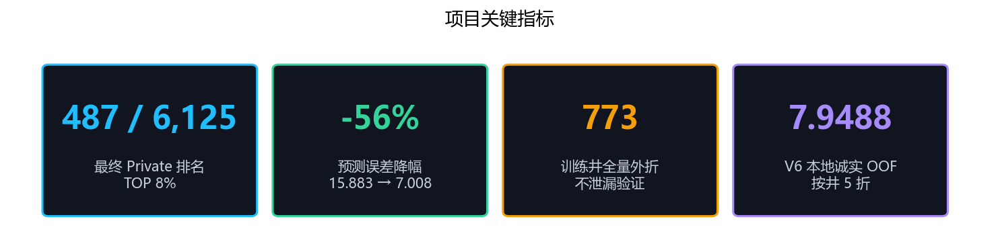

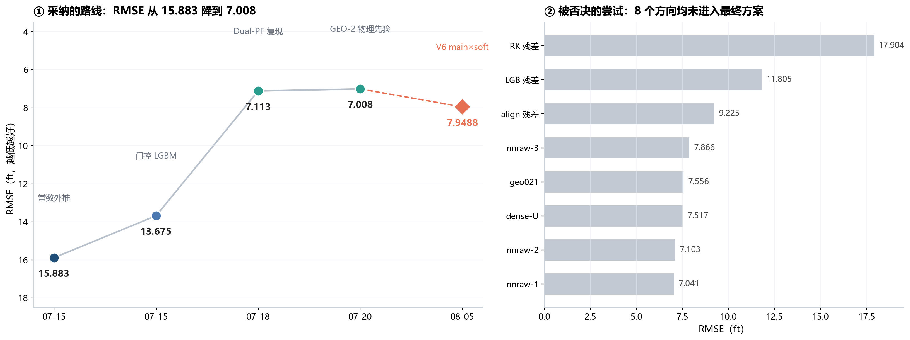

---

## 1. 项目背景与业务价值

水平井钻井时，钻头需要“打在地层目标层里”。工程师靠随钻测井（GR 等）判断当前钻遇的
地层位置，而**地层垂直坐标（TVT）预测**是地质导向的核心：提前知道轨迹会进入哪个层位，
才能及时调整井斜、避免打穿目标层。预测误差直接对应钻井风险和成本。

比赛给定每口水平井的井轨迹、测井曲线、已知前缀段的 TVT，以及一口参考直井
（typewell），要求预测评估区（未知段）的逐行 TVT。

**数据规模**：773 口训练井；隐藏测试约 200 口；公开样例仅 3 口井（14151 行）。

下面用一口真实训练井展示“问题长什么样”：① 是实测 GR 测井，② 是我们要预测的
目标曲线（TVT），③ 是参考直井提供的“地层地图”。任务可以概括为：**用 ① 和 ③
对齐，把 ② 从已知段（蓝）继续画进评估区（橙）**。

| ① 输入：实测 GR 测井 | ② 目标：TVT 曲线 |
|---|---|
| 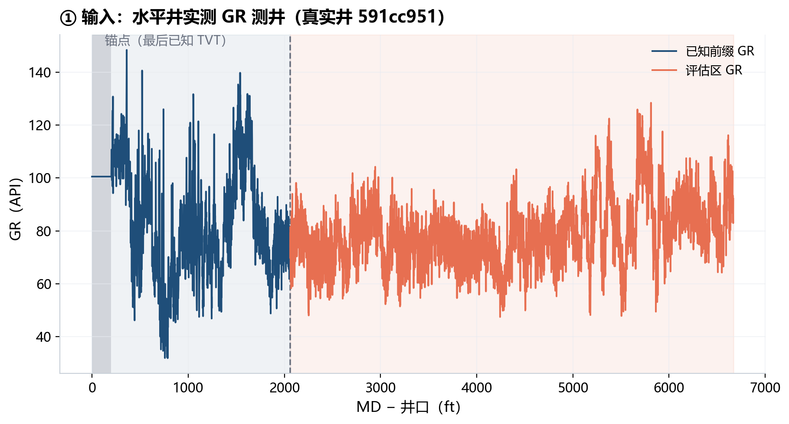 | 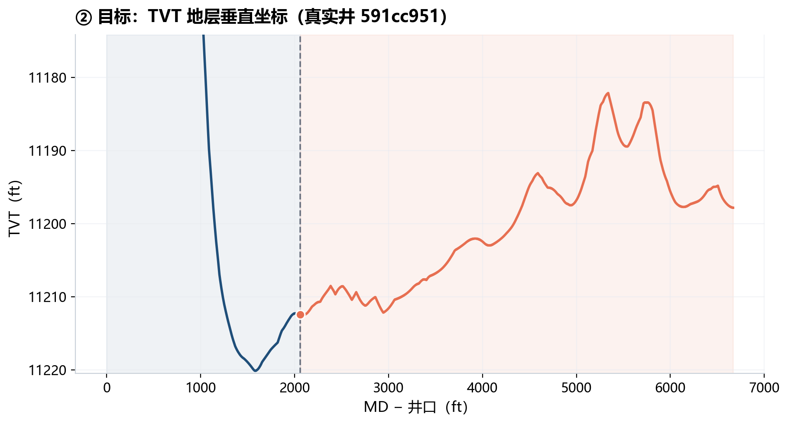 |

| ③ 参考地图：typewell 的 GR–TVT 映射 |
|---|
| 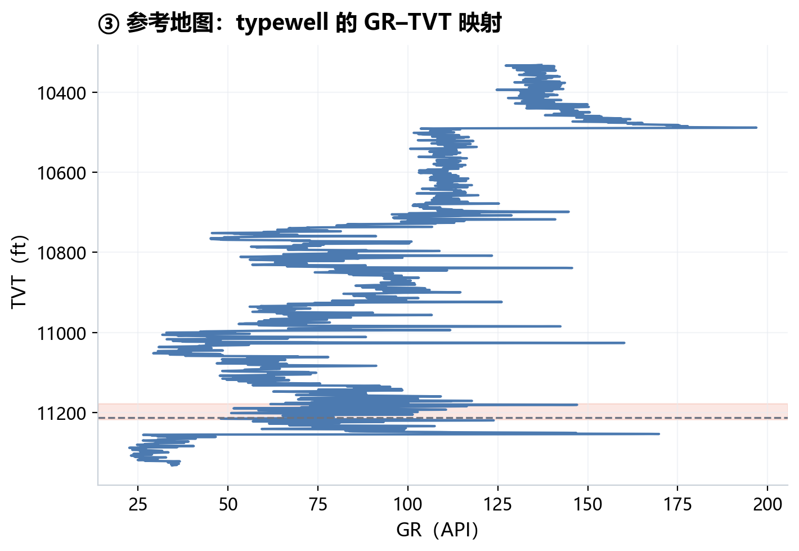 |

> 图 ② 中：虚线 = 已知前缀的最后锚点；橙色点 = 锚点位置。图 ③ 中：橙色带 =
> 本井 TVT 所在层段，虚线 = 锚点对应的参考深度。

---

## 2. 问题转化与定义

### 2.1 从领域问题到数据问题

| 领域概念 | 数据化定义 |
|----------|-----------|
| TVT（地层垂直坐标） | 目标变量 y |
| MD（测量井深，沿井轨迹的距离） | 序列坐标 |
| GR（自然伽马测井曲线） | 主要观测特征 |
| typewell（参考直井） | 外部标定信号（GR↔TVT 映射） |
| 评估区（未知段） | 待预测区间，标签只在训练井存在 |

最终建模目标：`TVT_t = f(MD, XYZ, GR, typewell, 前缀TVT)`，按行回归。

### 2.2 指标与难点

- 指标：评估区全部行的 pooled RMSE（点级等权）；
- 难点：**少数长而难的井主导总分**——我们的 EDA 显示最难 10% 的井贡献了约 57.8% 的
  总误差平方和（常数基线口径下约 52.5%）。这决定了整场比赛的优化纪律：
  **可以改难井，但绝不允许牺牲普通井**。

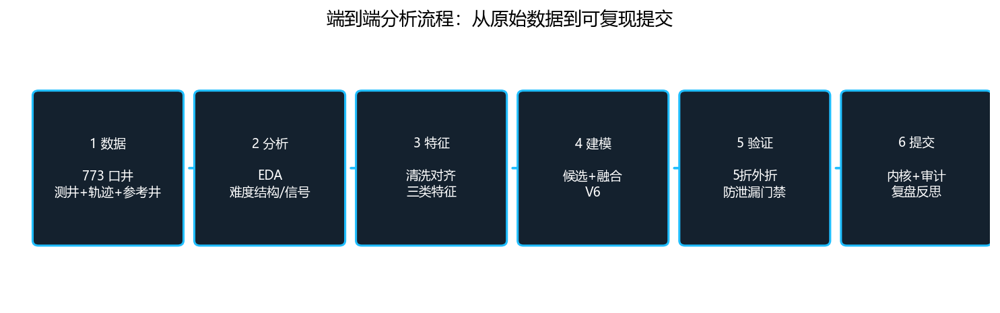

---

## 3. 数据分析（EDA）

这一节是整场比赛的“方向盘”：**先让数据说话，再定问题定义与改进方向**。我们最终
稳定住四个方向，每个都来自一组可复现的数据事实。

| # | 数据事实（下图） | 由此得出的方向 |
|---|------------------|----------------|
| 1 | 评估区中位长度 4,840 ft，是已知前缀（1,703 ft）的约 2.8 倍 | 这是**长程外推**问题：模型要用约 1,700 ft 的证据预测前方近 5,000 ft，纯短程表格拟合必然失效，特征必须能支撑远处外推 |
| 2 | GR 与参考直井存在匹配谷，但 GR 近似周期，出现多条平行谷 | 信号存在但有**相位歧义**：全局匹配会选错层，必须用已知前缀锁定相位后再做多尺度匹配 |
| 3 | 最难 10% 的井贡献超过一半误差平方和 | 误差高度集中：**保护普通井优先**，难井只接受可解释、有门禁的修正 |
| 4 | 全量 29.6% 的 GR 缺失，且常整段聚集（评估区 31.7%） | 数据质量必须**先于建模**处理：插值、稳健归一化、缺失占比特征 |

### 3.1 结构：这是一个长程外推问题

每口井的可见前缀（已知 TVT）和评估区长度差异很大，但共同点是评估区远长于前缀。
这意味着“外推距离”本身就是主要难度来源之一。

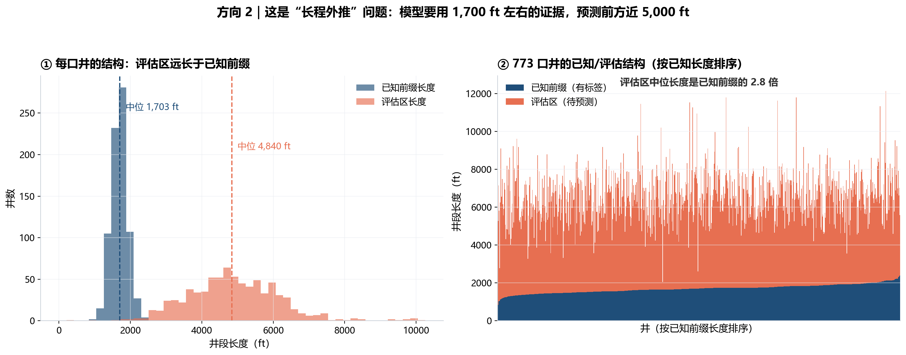

### 3.2 难度：少数硬井主导总分

用“最后一刻已知 TVT 直接外推”作为零模型（常数基线），可以量出每口井的天然难度。
分布高度右偏，且误差平方和集中在少数井上——**优化任何模型前，先想清楚它的失败
半径**：一个把普通井变差 0.1 ft、只让几口难井变好 3 ft 的方向，在总分上可能是负收益。

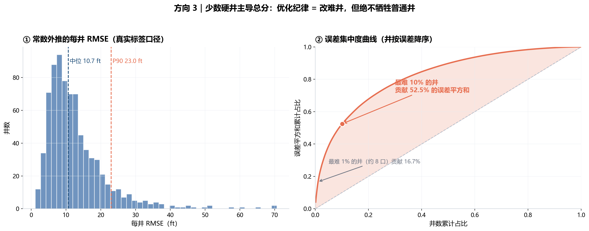

### 3.3 信号：GR 匹配谷就是轨迹候选

把一口井的评估区渲染成一张 2D 面板：横轴是井前方位置，纵轴是候选 TVT 相对锚点的
偏移，颜色是实测 GR 与参考直井 GR 的差异。**暗谷 = 该位置地层“最可能”所在的深度**。
图中白色虚线是这口井的真实 TVT 轨迹。可以看到：真实轨迹正好沿着谷走——信号是
真实存在的；但 GR 近似周期导致多条平行谷（好几个深度都“看起来对”），单独做全局
匹配很容易选错层位。这就是必须以前缀为锚、做多尺度匹配的原因。

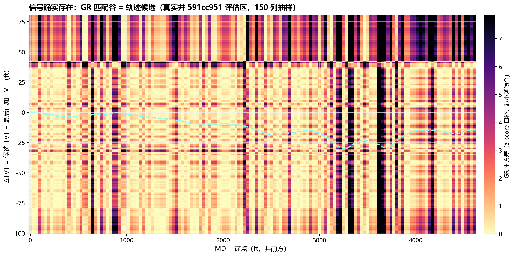

### 3.4 数据质量：处理必须先于建模

近三成 GR 缺失且呈段状聚集，不是随机噪声。我们在建模前完成了逐井插值、稳健截断与
归一化，并把缺失占比本身做成特征——这既保住样本，也让模型知道“这段证据不足”。

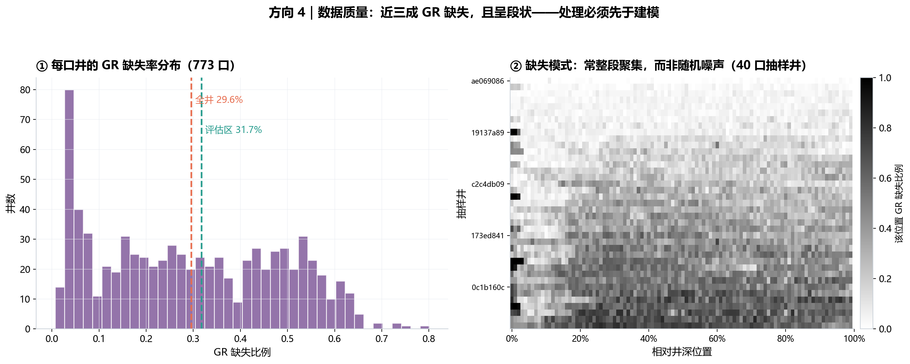

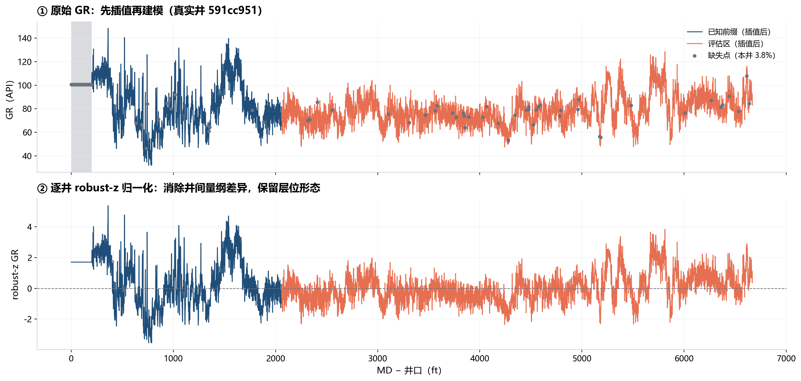

### 3.5 其他 EDA 结论

- 评估区集中在井尾（单侧锚点，无右端约束）；
- 水平井 GR 与 typewell GR 存在可对齐的层位信号，但**全局匹配不可靠**（独立 GR 匹配
  中位误差约 25 ft），必须用前缀段标定偏移后才有用；
- “晚发井”（误差沿井深快速放大）可被前缀特征识别，AUC 从 0.665 提升到约 0.70，
  成为 soft 门控的基础；
- 训练井与隐藏井的可见字段一致，测试侧无标签。

---

## 4. 数据处理

- **清洗**：NaN 分段线性插值、首尾回填；极端值按训练分布稳健截断；
- **归一化**：逐井 robust-z，避免井间量纲差异；
- **对齐**：把水平井 GR 与 typewell 在 TVT 网格上重采样，构造“GR↔地层”匹配面；
- **多源合并**：轨迹几何、测井、邻井地层曲面、前缀标定统一成逐行特征表。

核心原则：**所有处理都发生在“渲染”之前、以原始测井为基础，保证自洽**——模型看到
的每一个特征都可以追溯到原始数据，而不是黑箱流水线。

---

## 5. 特征工程

特征分三类，全部只用“预测时可见”的信息：

| 类别 | 内容 | 作用 |
|------|------|------|
| 轨迹几何 | MD/XYZ 导数、井斜方位、距锚点距离、斜率/曲率 | 描述井怎么走 |
| 测井匹配 | 多尺度相关、对齐偏移、峰谷特征、匹配质量与不确定性 | 描述地层在哪 |
| 井级统计 | 前缀稳定性、难度代理、晚发/易稳分类概率（`pred_late`/`pred_easy`） | 决定该信谁 |

最终进入软门控的是 **68 个井级合法特征** + 折外分类输出。

---

## 6. 模型设计

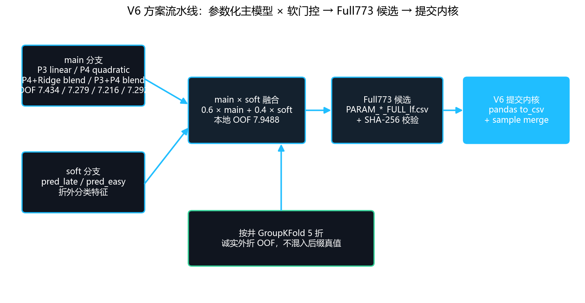

### 6.1 候选生成（让多个模型“提出答案”）

| 候选 | 组成 | 诚实 OOF |
|------|------|--------:|
| P3 | 参数化线性轨迹 | 7.4341 |
| P4 | 参数化二次轨迹 | 7.2794 |
| P4+Ridge | 参数化 + Ridge 融合（best OOF composite） | **7.2164** |
| P3+P4 | 保守曲率对冲 | 7.2924 |

此外还实验了粒子滤波（PF）、GBDT 残差、学习式对齐等，作为候选多样性来源。

### 6.2 融合：V6 = 0.6 × main + 0.4 × soft

```text
pred_v6 = 0.6 × main + 0.4 × soft
```

- main：参数化主模型家族；
- soft：`pred_late / pred_easy` 折外分类输出，代表“这口井需要保守还是信任主模型”；
- 固定权重、不按井硬切换：在小样本下避免过拟合；本地诚实 OOF = **7.9488**。

### 6.3 为什么“更复杂”没有赢

- “灾难井专用选择器”和“第三证据源（P4RIDGE）”在 oracle 上很强（部分灾难井可从
  35→6），但合法特征下收益回归器无法稳定区分，全局加入反而带坏普通井；
- 结论：**用可验证的门禁拒绝“看起来很美”的方向**，与业务上“先不伤害大多数”的
  原则一致。

### 6.4 Full773 提交内核（V6）

```text
PARAM_*_FULL_lf.csv（Full773 候选）
   → SHA-256 校验 → pandas 读入
   → 与 sample_submission 合并
   → pandas to_csv 写出 submission.csv
```

---

## 7. 验证与防泄漏（严谨性）

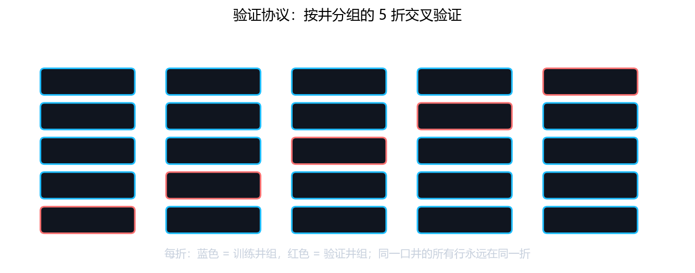

- **按井分组**：GroupKFold 5 折，同一口井全部样本同折；
- **外折合同**：候选特征对生产者是 OOF 的，下游训练不再触碰验证折；
- **null 对照**：每个新候选必须过 shuffle / matched-null 门，防止“容量被当能力”；
- **公榜纪律**：公榜只当作固定偏移参考，不用于调参；
- **失败分类**：死胡同 / 角色错误 / 时机错误 / 成本放弃，只有可解释的失败才被永久记录。

正是这套纪律，让我们拒绝了多个“本地 OOF 好看、实际会翻车”的方向。

---

## 8. 优化路线与反思

| 阶段 | 假设 / 动作 | 结果 | 反思 |
|------|------------|------|------|
| 地板 | 常数外推（const） | 15.883 | 先摸清任务下界，不盲目堆模型 |
| 第一版 ML | 残差 LGBM + 难度门控 | 13.675 | 特征信号不足时调参无效 |
| 公开管线对齐 | 复现并本地改造 Dual-PF | 7.113 | 公开方案是起点，不是终点 |
| 构造面先验 | GEO-2 多地层平面 + 前缀校准 | 7.008 | 物理先验比纯表格残差更稳，冻结为基线 |
| **最终方案** | **V6 main×soft 融合** | **7.9488（OOF）** | 软门控优于硬切换；稳健优先 |
| 提交修复 | v1–v4 写入失败 → V6 pandas 写出 | 出分 | **写出路径与模型同等重要** |

**试过但没有保留的方向**：自由残差叠加、硬门控切换、灾难井专用选择器、第三证据源
全局融合——每个都记录了失败分类与重开条件，而不是简单地“弃用”。


> 口径说明：① 中前 4 个节点是公开榜（Public LB）口径，最后一个菱形（V6 7.9488）
> 是按井分组的诚实 OOF 口径，比公榜更严格，因此数值“回弹”不代表退步；最终 Private
> 排名 487 / 6,125（TOP 8%）。② 中 8 个被否决的尝试均记录过失败分类（角色错误 /
> 公榜翻车 / 容量被当能力 / 嵌套 OOF 乐观），没有进入最终方案。

---

## 9. 工程与 Agent 协作（人主导 + AI 提效）

这场比赛不是“让 AI 替我参赛”，而是**人定义问题与验证合同，AI 负责执行、记录与审计**：

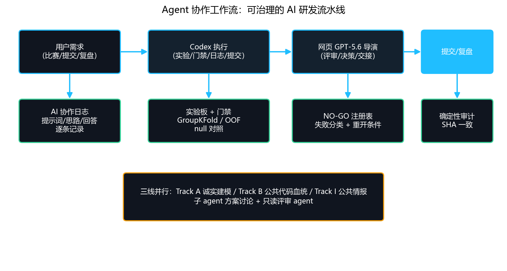

### 9.1 全过程留痕

从第一天起维护 `AI协作日志`：每一次交互记录**用户提示词 → AI 应用思路 → 回答摘要与产出物**，
让每个决策都可回放、可审计、可复盘。

### 9.2 三线并行的 agent 架构

- **Track A（诚实建模）**：Codex 维护全量 773 井、按井外折、不泄漏的模型注册表；
- **Track B（公共代码血统）**：对公开高分 notebook 做模块级审计与可迁移机制分析；
- **Track I（公共情报）**：结构化爬取讨论区与解法，形成情报库。

### 9.3 决策闭环

- 多子 agent 并行方案讨论 → 人拍板；
- 只读评审 agent 给出结构化评价与“不该继续投入”的清单；
- 网页 GPT-5.6 担任导演，每个周期通过“提示词 + 证据包”交接评审；
- NO-GO 注册表记录 `result / evidence / reason / reopen_condition`，
  只冻结上下文、不永久封杀组件；
- 确定性审计：Notebook 连续两次运行 SHA 一致，提交前校验行数与顺序。

### 9.4 这说明什么

AI 工具使用能力的核心不是“会提问”，而是**能不能给 AI 定义验证合同、审计它的产出、
把它的实验纳入工程纪律**。这套“人主导 + AI 提效”的流水线，就是我在本项目中证明的
能力。

---

## 10. 公开资料（论文与数据集）

### 数据集

- 官方竞赛数据：ROGII - Wellbore Geology Prediction（Kaggle，773 口训练井 +
  参考直井 + 地层顶界）；
- 数据来源说明：USGS ScienceBase 井筒地质数据条目（cwldb 元数据）。

### 论文 / 文献方向

围绕“测井曲线地层对比”与“地质导向轨迹估计”检索了以下方向的文献
（来源：OnePetro / SPE / EAGE / arXiv / Kaggle 官方解法）：

- 水平井地质导向与地层垂直厚度建模；
- 测井曲线自动对比（动态时间规整 DTW、多尺度互相关）；
- 粒子滤波 / 贝叶斯状态估计在轨迹预测中的应用；
- 地质模型不确定性量化与校准。

> 说明：本方案还参考了 Kaggle 公开讨论与基线实现；最终方案在本地全量 773 口井上
> 独立重构、按外折合同验证并固化，非直接搬运。

---

## 11. 目录与复现

```text
.
├── README.md
├── assets/                    # 可视化（真实数据 EDA / 问题定义 / 流水线 / Agent 工作流）
├── notebooks/
│   ├── full773_v6/            # Full773 v6 提交内核（4 个候选 + v6_meta）
│   └── main_soft_v6/          # V6 main×soft 全量 notebook
└── scripts/                   # V6 融合 / 构建 / 统计与配图脚本
```

提交内核是资产驱动的：真实隐藏测试替换候选 CSV（`PARAM_*_FULL_lf.csv` 完整版）后
直接运行 notebook；本地 `submission.csv` 为 3 口样例井冒烟输出，用于验证
行数 / id 顺序 / 无 NaN。所有指标均注明口径（本地 OOF / Public / Private）。
